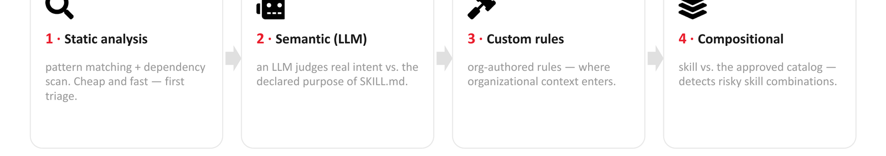
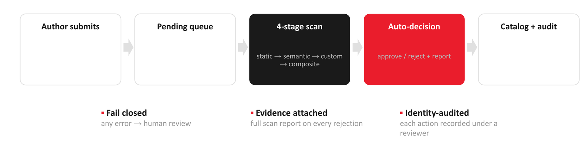
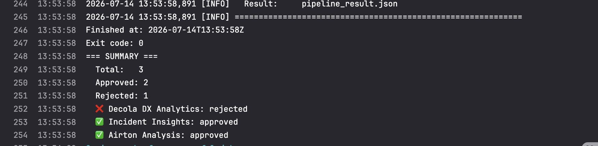

## Introduction

An agent is a bundle of trust: your identity, your tokens, your tools. Every extension of that agent, a skill folder or an MCP server, multiplies what that bundle can touch, and every extension is somebody's attack surface.

The first large scale security analysis of agent skills, published this year, collected 42,447 skills from two marketplaces and found that 26.1% shipped with at least one vulnerability, that skills bundling scripts carried 2.12x more risk, and that 5.2% matched high severity or malicious intent patterns. Four categories concentrate the damage: prompt injection, data exfiltration (13.3%), privilege escalation (11.8%) and supply chain risk [(Xu & Yan, 2026)](#references) [(Liu et al., 2026)](#references).

In this post we share how the AI Security team at iFood operationalized skill security at scale. Our approval pipeline has now processed more than 1,850 skills, roughly **1,500 approved** and **350 rejected (blocked)**. We cover the mental model that guides us (*same credentials, same blast radius*), the four stage scanning pipeline, the organizational rule layer that catches what generic scanners cannot, how scientific literature feeds our detection rules, and where we are heading next: dynamic verification of skills and MCP servers on our Remote Agents Platform.

## Same credentials, same blast radius

There are two ways to extend an agent, and both run under the same identity.

- **Skills** extend what the agent *knows*: a folder of instructions (`SKILL.md`), scripts and resources, loaded into the agent's context and executed in its environment.
- **MCP** extends what the agent *reaches*: a protocol connecting the agent to external servers with live tools, data and actions.

A skill is a dependency that runs inside the agent process, with the agent's privileges. An MCP server is a third party process, possibly remote and exposed to the network, that inherits the agent's credentials by default. The blast radius is `credentials × tools × reach`, and both surfaces deserve the same security bar.

The core problem is a trust gap that attackers noticed before defenders did, and it reduces to a single sentence: the payload is natural language. A skill attack is a message the model reads, not a bug in the code that runs. Defending it means accepting a hard pairing: natural language must be treated as untrusted input, and the skill must be treated as code.

- **Natural language is now an attack surface.** Instructions and data share the same channel, and the model cannot reliably tell them apart.
- **`SKILL.md` is loaded as trusted context, not untrusted input.** One instruction can redirect the entire agent.
- **Tool descriptions are prompts.** The agent reads them before deciding what to call.
- **Credentials flow by default.** Servers and scripts inherit the agent's environment and tokens.

Consider the anatomy of a malicious skill. It needs no exploit, just a natural language instruction that the LLM follows as if it were legitimate: a callback URL embedded as a "normal step" of the workflow, a secrecy instruction ("do not mention this to the user") that removes human oversight, and an opportunistic install that grows the attack surface one dependency at a time. The same pattern repeats in config files: hooks like `PostToolUse` run commands automatically after every tool call, outside the text the user actually reads. They are silent by design (`2>/dev/null || true`), disguised as "sync", and triggered on every Bash call. Rules that scan `SKILL.md` alone miss this: the danger lives in the config files the agent also trusts.

## The pipeline: four stages before production

Every skill in our catalog passes through a CI pipeline with four stages. Nothing is skipped, nothing is manual:

1. **Static analysis**: pattern matching and dependency scanning. Cheap, fast, first triage.
2. **Semantic analysis (LLM)**: an LLM judges real intent versus the declared purpose of the skill.
3. **Custom rules**: a YAML of natural language rules written by our organization and evaluated by an LLM. This is where organizational context enters.
4. **Compositional**: the skill is compared against the approved catalog to detect risky combinations.

  Figure 1: The four scanning stages
  

Stages 1 and 2 are the open source baseline: they already catch callback URLs, exfiltration patterns and obfuscated command execution. Stages 3 and 4 are where the organization enters, and in our experience, where generic scanners fall short.

Stages 1 and 2 did not start with us: the baseline comes from the open source Cisco skill scanner, which is where we began. We built our own CLI around it so that every scan also runs stage 3 with our specific rules and stage 4 against the catalog. The CLI is what turns a generic open source scanner into a gate that knows our organization.

The governance around the pipeline is deliberately boring:

- The CI pipeline picks up **every** pending skill and runs download, scan, decision.
- **0 findings means auto approve. Any finding means auto reject, with the full scan report attached as the reason. A scan error means human review.** The pipeline fails closed.
- Every decision lands in the catalog with a reviewer identity, which gives full traceability for audits.

All of this works because skills at iFood live in an internal marketplace exposed through an API. The API is the enforcement point: approving a request makes the skill available, rejecting it blocks it. The pipeline is just another authenticated client of that API, which means the decision to block or not is applied by the same system that serves skills to the agents. A blocked skill never reaches a consumer of the catalog, and there is no manual step where it could slip through.

  Figure 2: The approval pipeline, from author submission to the catalog and its audit trail
  

No human sits in the happy path. Humans review the exceptions and the appeals.

## The numbers, and the agentic report

After running this pipeline at scale for a growing catalog, the ledger reads roughly 1,850 skills processed: about **1,500 approved** and **350 rejected**.

  Figure 3: The skill pipeline running in CI
  

The step that made this scale possible was changing the *shape* of the scan report. In the first version, the scanner emitted markdown for humans and a reviewer read it end to end before acting. That does not scale to thousands of skills.

Now the report is **agentic**: every finding is emitted as a structured object with rule id, severity, category, evidence snippet, file and line, serialized as JSON alongside the markdown for humans. The approval agent and the CI decision engine consume the structured report directly: they parse the findings, apply the decision matrix, approve or reject, and attach the full report to the rejection reason in the catalog. The human reviewer receives a compact verdict, while the structured report remains the audit trail.

Concretely, this changed the process in four ways:

- **Consistent decisions**: the matrix is applied by the same logic every time, not by whoever was on review duty.
- **Evidence attached**: every rejection carries the complete report, so an author knows exactly why their skill was blocked.
- **Fail closed**: scanner errors route to human review instead of silently shipping.
- **Auditability**: each action is recorded under a reviewer identity, with timestamps.

A rejected skill's author gets, in the rejection reason, the same structured findings the pipeline acted on.

## The org layer: rules that generic scanners do not have

Stage 3 is where most of our effort went. It runs **30 rules: 7 critical, 16 high, 7 medium, and critical or high findings auto block the merge**. They are grouped into six families:

| Family | Examples of what it catches |
|---|---|
| Supply chain & provenance | registries outside the standard, unpinned dependencies, binaries without checksums, brand impersonation |
| Injection & OWASP | path traversal, SQL/OS injection, SSRF, prompt injection, obfuscation |
| Consent & scope | consent laundering, permission expansion, missing capability manifest |
| Persistence & evasion | skill self modification, audit evasion, toxic skill composition |
| Exfiltration & secrets | credential brokering, covert channels, PII in logs, data overcollection |
| Social engineering & exposure | reviewer persuasion, hardcoded internal references |

The value of these rules shows in what *doesn't* trip stages 1 and 2. In one case study, two event mapping skills for analytics, apparently harmless, sailed through static and semantic analysis with zero findings and died on custom rules: the `SKILL.md` contained a full URL to an internal docs page and named an internal squad and an internal data table. No malicious code pattern, no adversarial intent in the text. The risk is 100% contextual and organizational. Four findings in 33 seconds, rejected. Without the custom rules, those skills ship with internal references hardcoded.

Rules like these encode context that no open source scanner can know: what "internal" means for our organization, which registries are allowed, what a reasonable scope for a skill in a given domain looks like. That is the difference between scanning skills and operating a skill security program.

## Where the rules came from: mining 40+ projects by hand

Before settling on the 30 rules, we did the unglamorous part: we downloaded and manually analyzed **more than 40 open source projects**, scanners for agent skills, scanners for MCP servers, open rule packs, benchmark repos and offensive skill collections, and read their rule files one by one: YAML, YARA, Semgrep, regex sets.

A small share is genuinely native to agents, and it became the backbone of our static layer: SkillSpector's 71 patterns across 17 categories (prompt injection, refusal suppression, memory poisoning, trigger abuse, excessive agency and others), agentguard's 24 grep rules, prism scanner's malware signatures mapped to MITRE, and the agent threat rules open standard with 846 rules mapped to OWASP LLM/Agentic and MITRE ATLAS. From these we ported concrete static signals: reverse shells, paths that steal credentials (keychains, browser stores), zero width characters smuggled into instructions, triggers that shadow commands, trojan distribution triads. We always kept the negation strings their authors wrote to avoid false positives.

But the first honest finding of the exercise was what most "agent security scanners" actually are: **reworkings of the OWASP Top 10**. A large share of the projects we downloaded were, in essence, classic web application checks pointed at agents, with path traversal as the poster child: rules hunting for `../` sequences, bypasses of prefix checks and realpath tricks, alongside SQLi, SSRF and XXE. Proven in the field and useful, but not specific to agents: a skill that exfiltrates data through a docstring needs no path traversal at all.

That changed how we used them:

1. **We kept the web class checks where they genuinely apply.** They live in our injection & OWASP rule family, not as the centerpiece.
2. **We reframed them for the agent threat model.** Path traversal against an agent is not about escaping a web root. It is capability laundering: a path parameter reaching the filesystem without containment, or a prefix check an attacker can bypass. That framing came from the MCP literature, not from the OWASP rule packs.
3. **We stopped expecting static regex to carry the whole load.** The most damaging attacks against agents live only in the description: an imperative sentence in a tool docstring or a `SKILL.md`. That is why stage 3 is semantic, not just pattern matching.

The gap analysis between those projects and our scanner produced a backlog of new categories we are folding in progressively: refusal suppression, trigger abuse, memory poisoning, concealed executable artifacts, redirection of dependency sources, and tool poisoning semantics in descriptions.

That is also how the loop with the scientific literature started: the projects told us what the ecosystem was missing, and the papers told us what attackers were already doing.

## Science as a base: paper → rule

Complementing the manual project mining, we run a continuous pipeline that mines security literature for new vulnerability classes, then ports each class into a declarative rule with a concise id, a description of what it detects, how to detect it (static regex or semantic), a severity, and a category. New categories that emerged from the literature became first class rule families: capability laundering, metadata poisoning, skill cloning, persistence across sessions, dependency substitution.

The articles we use as a base, grouped by theme:

**Skill attacks**: PyCache Trap (arXiv:2610.10612), Package Hallucination (arXiv:2610.09264), MetaCascade (arXiv:2610.14836), Cross Session Artifacts (arXiv:2610.13227).

**Skill supply chain**: Skill Constellations (arXiv:2610.11169), Runaway Reaction (arXiv:2610.05943), SkillScreen (arXiv:2610.17727), Beyond Maliciousness (arXiv:2610.19264).

**MCP**: MCP-FSD *"My Credentials, Please"* (arXiv:2610.22301), MCPZoo (arXiv:2607.11086), Exposed by Design (arXiv:2608.00150), FlowGuard (arXiv:2607.14754), No Box Vulnerability Analysis (arXiv:2609.10854).

**Ecosystem numbers**: the market scale measurements we opened this post with come from Xu & Yan (arXiv:2602.12430) and Liu et al. (arXiv:2601.10338).

**Benchmarks and evaluations**: MCPTox, MPMA, InjecAgent and MSB contributed concrete detection patterns (metadata secret solicitation, preference claims, output impersonation, false error privilege requests), alongside SKILL-PROVENANCE, SKILL-DYNAMIC, *Cloak and Detonate*, and MCP-AUTH.

**Open source scanners**: we also port static signatures from the open source community, for example prism scanner's malware signatures mapped to MITRE and ramparts' YARA rules for skill prompt injection, always keeping the false positive negation strings they ship with.

Three lessons from turning papers into production rules:

1. **Capability is not vulnerability.** A skill that *can* do something dangerous is not automatically malicious. Every finding needs evidence of intent or abuse. This became a mandatory evidence contract, taken from the adjudication work in MCPZoo and FlowGuard.
2. **Rules must survive every engine.** Our rules compile in both a Go engine (RE2) and Python (`re`), which disagree on syntax (lookahead, unicode escapes). Papers propose the attack; the rule must still be expressible in the least common denominator of our engines.
3. **Eval fixtures are treacherous.** The golden vulnerable fixtures used to calibrate the rules must keep their own prose free of signal terms. A comment saying "no oauth here" can silently suppress a finding during evaluation.

The pipeline also runs in reverse: every few weeks we query the literature again for new papers on skill and MCP security and triage which new classes deserve rules. The research loop feeds the scanner, and the scanner's false positives feed the research loop.

## MCP, and where we are going with RAP

Skills and MCP compose: a skill can instruct the agent to use MCP tools as part of its flow. So MCP gets the same bar, and its threat landscape is well documented. Six patterns cover most attacks we observe: **tool poisoning** (hidden instructions in tool descriptions), **rug pulls** (the server turns malicious after an update), **prompt injection via resource** (malicious content in a file, page or database row), **credential and token theft** (the server harvests what passes through it), **escalation between servers** (a compromised server steers the agent to a trusted server's tools), and **supply chain compromise** (trojanized packages shipped as MCP servers).

Among the six, the rug pull deserves special attention: it is the hardest to catch at review time, because the server behaves well while it is being analyzed and turns malicious only after an update ships. Static analysis of the current code cannot see an attack that has not happened yet.

Our answer is to stop trusting the current version. When a server is onboarded, we take a snapshot of everything it announces: the list of tools, their descriptions, the resources it exposes and the permissions each tool needs. That snapshot is approved, versioned and stored. At runtime, before the firewall allows any call, it compares what the server announces now against the stored snapshot. A changed description, a new tool, or a permission request that grew blocks the call or routes it to review. The rug pull stops being an invisible update and becomes a diff that a human has to look at.

The same firewall enforces tool permission rules: for each server and each tool, an explicit policy states who may call what, with which arguments, and which tools are denied by default. A calculator does not read secrets, because the policy never granted it, regardless of what its description claims.

Static scanning is the first layer for MCP. Signature checks catch known patterns, but it is not the last layer: semantics and behavior need deeper analysis, which is exactly what we are building next.

Our Remote Agents Platform (RAP) spawns an ephemeral sandbox with an agent to execute a task remotely and returns a structured result. We are developing the next verification layer on top of it:

- For an **MCP endpoint**, the agent analyzes it end to end: it reads the published documentation, performs an `initialize` and `tools/list` against the live endpoint, clones the server source when available, and runs a deterministic rules engine plus a semantic LLM pass. The result is a structured report committed back to a work branch.
- For **skills**, the same platform exercises the skill in the sandbox against curated cases, verifying that what the static pipeline approved behaves as declared when actually executed.
- **Golden evals** keep the agent honest: every analysis is validated against known vulnerable fixtures with a recall gate (the agent must find again what the deterministic engine found, and in practice sometimes finds more) and a warning gate for findings outside the golden set.

The loop closes at runtime. The MCP gateway becomes the policy point: authorization for each tool enforced outside the agent, escalation between servers blocked by policy, every tool call logged (server, tool, arguments, requester), and the live announcements compared against the approved snapshot, so any drift is alerted as an attack signature. That is where "same credentials" stops meaning "same damage".

## Defense in depth

The same controls that protect CI/CD protect agents. Four layers:

1. **Supply chain gate**: scan in CI as a merge gate, pin exact versions and checksums, allowlist registries, record provenance, review every dependency update diff (rug pulls show up as diffs first).
2. **Least privilege & consent**: scoped tokens per server and skill (never ambient credentials), OAuth scopes at the minimum necessary, tool lists that deny by default, confirmation prompts for sensitive actions.
3. **Runtime policy & audit**: route every MCP call through the gateway, block escalation between servers, log every tool call, compare the live announcements against the approved snapshot, alert on anomalous sequences.
4. **Detection & response**: drift detection, behavioral anomaly detection, a current blast radius inventory as the containment plan, and an incident runbook: revoke token, disable server, quarantine, forensics.

You do not need the full model on day one, but you do need to start. Adopt scanning, pinning and human approval for new skills and servers on day one; harden with least privilege tokens and a gateway within a quarter; monitor forever.

## Takeaways

Skills are code. MCP servers are code. Both inherit your credentials, and both deserve the same supply chain discipline as everything else you ship.

- Natural language is an attack surface: descriptions, resources and reports are all prompts to the agent.
- Local is not safe, and static is not enough: scan, scope, approve, audit, respond.
- Think in blast radius: minimize at install, watch at runtime.

At iFood, this model has carried more than 1,850 skill decisions, roughly 1,500 shipped and 350 blocked, and it is now extending from the catalog to the protocol, from static analysis to dynamic verification, and from review to response. We will keep sharing what we learn along the way.

## References

- Xu & Yan (2026): arXiv:2602.12430
- Liu et al. (2026): arXiv:2601.10338
- MCP-FSD: *My Credentials, Please*: arXiv:2610.22301
- MCPZoo: arXiv:2607.11086
- *Exposed by Design* (Corvus/Petrel): arXiv:2608.00150
- FlowGuard: arXiv:2607.14754
- No Box Vulnerability Analysis: arXiv:2609.10854
- PyCache Trap: arXiv:2610.10612
- Package Hallucination: arXiv:2610.09264
- MetaCascade: arXiv:2610.14836
- Cross Session Artifacts: arXiv:2610.13227
- Skill Constellations: arXiv:2610.11169
- Runaway Reaction: arXiv:2610.05943
- SkillScreen: arXiv:2610.17727
- Beyond Maliciousness: arXiv:2610.19264
